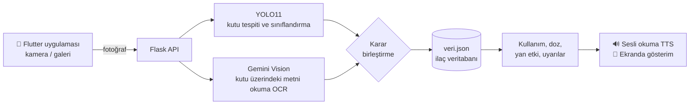

<div align="center">

# 💊 İlaç Tanıma Asistanı

**İlaç kutusunun fotoğrafını çekin, ilacı tanısın ve kullanım bilgisini sesli ve yazılı sunsun. Görme engelli kullanıcılar için tasarlanmış yapay zeka tabanlı mobil asistan.**


</div>

---

## Problem

Görme engelli bir kullanıcı için birbirine benzeyen ilaç kutularını ayırt etmek riskli bir iştir. Yanlış ilaç, yanlış doz demektir. Bu proje, telefon kamerasıyla ilaç kutusunu tanıyıp **ilacın ne işe yaradığını, dozunu, yan etkilerini ve uyarılarını sesli okuyan** bir asistan sunar.

## Nasıl çalışır?

Sistem iki yapay zeka katmanını birlikte kullanan **hibrit** bir mimaridir:



1. **YOLO11** ilaç kutusunu hızlıca tespit edip hangi ilaç olduğunu tahmin eder.
2. **Gemini Vision** kutunun üzerindeki yazıyı okur ve YOLO tahminini ikinci bir kaynakla doğrular.
3. Tanınan ilacın bilgileri **`veri.json`** veritabanından getirilir ve kullanıcıya sesli ve yazılı sunulur.

Tek bir modele güvenmek yerine iki bağımsız kaynağın birleştirilmesi, benzer kutularda yanlış tanıma riskini azaltmayı hedefler.

## Bu depoda ne var?

| Dosya | İçerik |
|---|---|
| [`yolo11_ilac_best.pt`](yolo11_ilac_best.pt) | Eğitilmiş YOLO11n ağırlıkları (13 ilaç sınıfı, Kaggle'da 50 epoch) |
| [`veri.json`](veri.json) | 13 ilacın veritabanı: kullanım, doz, yan etkiler, uyarılar, ilaç sınıfı |
| [`tahmin_ornek.py`](tahmin_ornek.py) | Modeli ve veritabanını birlikte kullanan, çalıştırmaya hazır örnek |
| [`requirements.txt`](requirements.txt) | Python bağımlılıkları |

Flutter mobil uygulaması ve Flask API'nin kaynak kodu bu depoda yer almaz. Yukarıdaki mimari sistemin tamamını anlatır. Bu depo, sistemin **yapay zeka modeli ve bilgi katmanını** paylaşır.

## Tanınan ilaçlar

| # | İlaç | Kullanım alanı |
|---|---|---|
| 1 | **Dolorex** | Ağrı kesici, ateş düşürücü, iltihap giderici |
| 2 | **Deloday** | Alerjik rinit ve ürtiker |
| 3 | **Parol** | Ağrı kesici |
| 4 | **Coldaway C** | Soğuk algınlığı |
| 5 | **Narisat** | Alerjik rinit spreyi |
| 6 | **Majezik** | İltihap ve ağrı |
| 7 | **Azenose** | Alerjik rinit |
| 8 | **Beklomil** | Astım inhaleri |
| 9 | **Tantum Verde** | Boğaz iltihabı |
| 10 | **Fardoben** | Boğaz enfeksiyonu |
| 11 | **Aksef** | Antibiyotik |
| 12 | **Buscopan** | Mide krampı |
| 13 | **Erdobil** | Anti-konvülsan |

## Hızlı başlangıç

```bash
git clone https://github.com/ahmetkc58/ilac_tanima_sistemi.git
cd ilac_tanima_sistemi

python -m venv venv
source venv/bin/activate            # Windows: venv\Scripts\activate
pip install ultralytics
```

Bir ilaç kutusu fotoğrafıyla dene:

```bash
python tahmin_ornek.py kutu.jpg
```

Örnek çıktı biçimi:

```text
Tespit: dolorex  (güven: 0.93)
Sınıf        : NSAİİ (Non-Steroidal Anti-inflammatory Drug)
Kullanım     : Ağrı kesici, ateş düşürücü ve iltihap giderici ...
Doz          : Günde 3-4 kez 400-600mg
Yan etkiler  : Mide bulantısı, Kusma, ...
Uyarılar     : Mide rahatsızlığı olanlar uyarılı kullanmalı; ...
```

(Güven değeri örnektir, gerçek çıktı fotoğrafa göre değişir.)

### Python'dan doğrudan kullanım

```python
from ultralytics import YOLO

model = YOLO("yolo11_ilac_best.pt")
sonuc = model.predict("kutu.jpg", conf=0.25)[0]

for kutu in sonuc.boxes:
    print(sonuc.names[int(kutu.cls)], float(kutu.conf))
```

## Veritabanı biçimi

`veri.json` içindeki her kayıt şu alanlara sahiptir:

```json
{
  "isim": "Dolorex",
  "kullanim": "Ağrı kesici, ateş düşürücü ...",
  "yan_etkiler": ["Mide bulantısı", "Kusma"],
  "dozu": "Günde 3-4 kez 400-600mg",
  "uyarilar": ["Mide rahatsızlığı olanlar uyarılı kullanmalı"],
  "sinif": "NSAİİ"
}
```

Yeni ilaç eklemek için hem modeli yeni sınıfla yeniden eğitmen hem de `veri.json`'a kayıt eklemen gerekir. Model sınıf adı ile `isim` alanı büyük/küçük harf farkı gözetilmeden eşleştirilir.

## Mobil uygulama ve API ile entegrasyon

Sistemin tamamında Flutter uygulaması fotoğrafı bir Flask servisine gönderir. Servisin sunduğu uç noktalar:

| Yöntem | Uç nokta | İşlev |
|---|---|---|
| `GET` | `/health` | Sistem sağlık kontrolü |
| `POST` | `/analyze` | Tam analiz (YOLO + OCR + veritabanı) |
| `POST` | `/yolo-detect` | Yalnızca YOLO tespiti |
| `POST` | `/ocr` | Yalnızca OCR |
| `GET` | `/medicine/<ad>` | İlaç bilgisi |

Gemini API anahtarı kodun içine yazılmaz, `.env` dosyasında `GEMINI_API_KEY` olarak tutulur ve **asla depoya yüklenmez**. Anahtarı [Google AI Studio](https://aistudio.google.com/app/apikey) üzerinden oluşturabilirsin.

## ⚠️ Önemli uyarı

Bu sistem **tıbbi tavsiye vermez** ve bir sağlık uzmanının yerini tutmaz. Yalnızca bilgilendirme ve erişilebilirlik amaçlı bir bitirme projesidir. İlaç kullanımı konusunda her zaman doktorunuza veya eczacınıza danışın, prospektüsü esas alın.

**Sınırlamalar:** Yalnızca yukarıdaki 13 ilacı tanır. Karanlık, bulanık veya çok açılı fotoğraflarda tespit başarısız olabilir. Kutunun düz ve iyi ışıkta çekilmesi önerilir.

## Yol haritası

- [ ] Daha fazla ilaç sınıfı
- [ ] Çevrimdışı çalışma (yerel OCR)
- [ ] Geçmiş taramalar listesi

## Lisans

MIT. Detay için [LICENSE](LICENSE).

---

<div align="center">

Geliştirici: **Ahmet Koç** · [GitHub](https://github.com/ahmetkc58) · [LinkedIn](https://linkedin.com/in/ahmetkoc) · [kocengineer.com](https://kocengineer.com)

</div>
